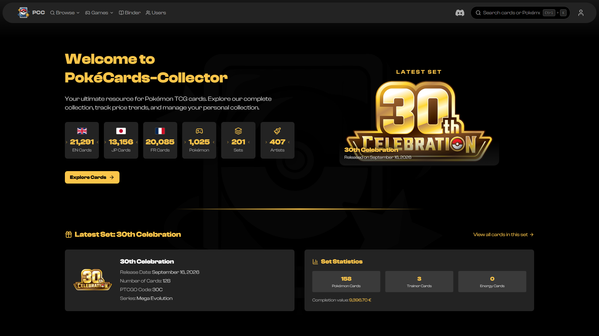

<div align="center">
  

  # PokéCards-Collector

  [](https://www.gnu.org/licenses/gpl-3.0)
  [](https://svelte.dev/docs/kit)
  [](https://svelte.dev/docs/svelte/what-are-runes)
  [](https://supabase.com/)
  [](https://www.typescriptlang.org/)
  [](https://tailwindcss.com/)
  [](https://workers.cloudflare.com/)
  [](https://bun.sh/)

  <p>A web application for browsing the Pokémon TCG catalogue and managing your collection</p>
</div>

## 📋 Overview

PokéCards-Collector browses the full Pokémon Trading Card Game catalogue - English, Japanese and French - and tracks what
you own and what you want. Cards, prices and sets come from [TCGdex](https://tcgdex.dev/), Pokédex entries from
[PokéAPI](https://pokeapi.co/). Everything is stored in Supabase Postgres, the catalogue is published as snapshots to
a Cloudflare R2 bucket, and a SvelteKit app running on Cloudflare Workers serves it all.

### 📸 Website

Live at [pokecards-collector.ayfri.com](https://pokecards-collector.ayfri.com).



## ✨ Features

<table>
  <tr>
    <td>🔍</td>
    <td><b>Card Browser</b></td>
    <td>Every card at <code>/cards-list</code>, with filters on set, type, rarity, artist, dex number and price.</td>
  </tr>
  <tr>
    <td>🇯🇵</td>
    <td><b>Japanese Catalogue</b></td>
    <td><code>/japan</code> is a parallel data set with its own cards, sets and prices.</td>
  </tr>
  <tr>
    <td>🇫🇷</td>
    <td><b>French Catalogue</b></td>
    <td><code>/france</code> is another parallel data set. A card with no French scan shows the English one, and prices are the English ones, since TCGdex maps both to the same Cardmarket product.</td>
  </tr>
  <tr>
    <td>📚</td>
    <td><b>Collection & Wishlist</b></td>
    <td>Track owned cards with quantities, keep a wishlist, and browse the public ones of other collectors.</td>
  </tr>
  <tr>
    <td>🗂️</td>
    <td><b>Binder</b></td>
    <td>Lay out digital binder pages and export them as an image, from card art or your own URLs.</td>
  </tr>
  <tr>
    <td>🧩</td>
    <td><b>Daily Games</b></td>
    <td><code>/card.dle</code> guesses the mystery card of the day, <code>/guess-the-price</code> its market value.</td>
  </tr>
  <tr>
    <td>🎨</td>
    <td><b>Artists, Sets, Pokédex, Trainers</b></td>
    <td>Browse by illustrator, by set and series, by Pokémon with its dex entry, or by Trainer and Energy card with all its prints grouped.</td>
  </tr>
  <tr>
    <td>🔐</td>
    <td><b>Accounts</b></td>
    <td>Supabase auth, public or private profiles, user search.</td>
  </tr>
  <tr>
    <td>🤖</td>
    <td><b>Data Pipeline</b></td>
    <td>A scraper CLI for full refreshes, plus a Cloudflare Workflow that refreshes Supabase every day and publishes the catalogue to R2.</td>
  </tr>
</table>

## 🛠️ Tech Stack

| Layer | What |
| --- | --- |
| Frontend | SvelteKit 3 + [Svelte 5 runes](https://svelte.dev/docs/svelte/what-are-runes), TypeScript, Tailwind CSS 4 (CSS-first, no config file), [Lucide icons](https://lucide.dev/) |
| Data | Supabase Postgres with row level security, catalogue snapshots in Cloudflare R2, [TCGdex](https://tcgdex.dev/) for cards/prices/sets, [PokéAPI](https://pokeapi.co/) for Pokédex entries |
| Hosting | Cloudflare Workers with static assets, via `@sveltejs/adapter-cloudflare` |
| Jobs | A second Worker holding a Cloudflare Workflow, scheduled daily |
| Tooling | Bun (runtime, package manager and lockfile), Wrangler, Vite, `svelte-check` |

## 🚀 Getting Started

<details>
<summary><b>Prerequisites</b></summary>

- [Bun](https://bun.sh/docs/installation) 1.4 or later
- A [Supabase](https://supabase.com/) project
- A [Cloudflare](https://www.cloudflare.com/) account with R2, for the catalogue bucket and the two Workers
- A [CardTrader](https://www.cardtrader.com/) API token, for the card scans TCGdex has none for

TCGdex needs no API key.
</details>

<details open>
<summary><b>Installation</b></summary>

1. **Clone the repository:**
   ```bash
   git clone https://github.com/Ayfri/PokeCards-Collector.git
   cd PokeCards-Collector
   ```

2. **Install dependencies:**
   ```bash
   bun install
   ```

3. **Set up the database:**
   - Create a project on [Supabase](https://supabase.com/)
   - `supabase/migrations/` holds the schema changes from 2026-10-31 on, run in filename order from the SQL Editor.
     The base schema they apply to (the catalogue tables, profiles, collections, wishlists and their row level
     security) isn't in the repository, so a new project starts from a schema dump of an existing one.
   - Grab the project URL and the keys from Project Settings > API Keys

4. **Configure environment variables:**
   Copy `.env.example` to `.env` and fill it in:
   ```dotenv
   PUBLIC_SUPABASE_URL=https://<project>.supabase.co
   PUBLIC_SUPABASE_PUBLISHABLE_KEY=sb_publishable_...
   SUPABASE_SECRET_KEY=sb_secret_...
   SCRAPER_TRIGGER_TOKEN=
   SCRAPER_URL=https://<scraper-worker>.workers.dev
   CARDTRADER_TOKEN=
   PUBLIC_NO_IMAGES=false
   ```
   `SUPABASE_SECRET_KEY` bypasses row level security and must never carry the `PUBLIC_` prefix: SvelteKit
   serialises every `PUBLIC_` variable into the SSR HTML. In production it is a Wrangler secret.

5. **Create the catalogue bucket and deploy the scraper Worker**, which is the one that publishes to it
   (see "Scheduled refresh" below for its secrets):
   ```bash
   bunx wrangler login
   bunx wrangler r2 bucket create pokecards-catalogue --location weur
   bun run deploy:scraper
   ```
   Point `SCRAPER_URL` in `.env` at your scraper Worker.

6. **Fill the database and publish the catalogue:**
   ```bash
   bun run scrapers all
   ```
   The catalogue pages answer a 500 until this first publish.

7. **Run the development server:**
   ```bash
   bun run dev
   ```
   The app runs on `http://localhost:5173` and reads the real bucket, through the `wrangler login` session.
</details>

## 📊 Data Scraping

`bun run scrapers` opens an interactive menu, `bun run scrapers <command>` runs one command directly, and
`bun run scrapers --help` lists everything.

<details>
<summary><b>Commands</b></summary>

| Command | Description | Needs |
| --- | --- | --- |
| `all` | `scrape`, then `pokemons`, then `supabase all`, in dependency order. | Supabase credentials, `CARDTRADER_TOKEN` and `SCRAPER_TRIGGER_TOKEN` |
| `scrape` | Fetch every card, price and set from TCGdex into `src/assets/`, with the CardTrader scans for the cards TCGdex has none for. `--lang en,ja,fr` picks the languages, all three by default. | `CARDTRADER_TOKEN` |
| `pokemons` | Fetch Pokédex names and descriptions from PokéAPI. | Nothing |
| `audit` | Match every stored `card_code` to its TCGdex card, rebuild `set-aliases.json` and `card-code-overrides.json` (English and Japanese) and `set-names.json` (the localized set names the collection import matches), report the owned codes pointing at no card and the French vocabulary missing from `french.ts`. | Supabase credentials |
| `link` | Match every Japanese card to its English twin and write `src/scrapers/tcgdex/jp-twins.json`, and every Japanese set to its English set in `jp-set-twins.json` (artwork hashes are cached in `.cache/`). Rerun it after a scrape that adds Japanese sets. | Nothing |
| `check` | Read-only sanity pass over the live catalogue: duplicates (card and set slugs included), orphans, unranked rarities, mismatched species, shared Cardmarket products, empty sets. | Supabase credentials |
| `purge` | Delete the cards, prices and sets of an excluded serie (Pokémon TCG Pocket), then publish the catalogue when something was deleted. | Supabase credentials and `SCRAPER_TRIGGER_TOKEN` |
| `verify` | Check the scraped JSON for `card_code` collisions (within and across catalogues), card and set slug collisions, unknown values, shared set names and owned cards that no longer resolve. `--offline` skips Supabase. | `scrape` |
| `supabase <target>` | Push one JSON file into its table: `all`, `cards`, `jp-cards`, `fr-cards`, `prices`, `jp-prices`, `fr-prices`, `sets`, `jp-sets`, `fr-sets`, `types`, `pokemons`. `--dry-run` only prints each table with the row count of its staged file. The upload ends by publishing the catalogue. | `scrape` and `SCRAPER_TRIGGER_TOKEN` |
| `publish` | Ask the scraper Worker to publish the catalogue snapshots to R2 from what Supabase holds, which is what the site reads. | `SCRAPER_TRIGGER_TOKEN` |

`--dry-run` (run without writing to `src/assets/`, Supabase or R2) is taken by `all`, `scrape`, `pokemons`, `audit`, `link`, `purge`, `supabase` and `publish`, so `all --dry-run` writes nothing anywhere. `--json` (raw report) is taken by `scrape`, `link`, `verify`, `check`, `purge`, `supabase` and `publish`. Every command takes `-q` (summary only) and `--help`.

A full pass takes about 15 s for ~36 000 cards, the CLI going through an HTTP/2 connection pool. `supabase` needs
the sets uploaded before the cards, and the cards before the prices; `all` already orders them. Run `verify`
between `scrape` and the upload to check the output.
</details>

<details>
<summary><b>Scheduled refresh</b></summary>

`src/workers/scraper.ts` is a second Worker holding the `ScrapeWorkflow` Cloudflare Workflow. It fires every
day at 04:00 UTC, one Workflow step per batch of 4 sets so a failing batch retries alone, and writes TCGdex
straight into Supabase with no staged JSON, for English, Japanese and French. A first step rebuilds the Cardmarket product
-> CardTrader scan map in the SQLite storage of the Durable Object, and the batches look their scans up there. A batch moves a card whose override gives it another code, deletes the
cards and prices TCGdex dropped from its sets, and skips the sets TCGdex holds no card for; a last step per language
clears the price, Cardmarket link and CardTrader scan of cards sharing a Cardmarket product with a differently named card. Every delete is scoped to a
set TCGdex answered for, so a half-finished pass never removes rows it has not reached. The TCGdex reads run in a
Durable Object pinned to Western Europe, since `api.tcgdex.net` is geo-DNS and its North American mirrors serve a
stale build.

The last step publishes the catalogue: every table becomes one gzipped JSON object in the `pokecards-catalogue` R2
bucket, named after the hash of its content, and a `manifest.json` written last names the current object of each
table. The site reads the catalogue from these objects only, so a publish is what puts an upload live. The step runs
even when a language failed, since Supabase already holds what its batches wrote. After each publish, a Discord embed
lists per language only what the new snapshot adds to the previous one (sets, cards, images, prices, artists and
Pokémon), each with its total, and the share of cards that have an image when images were added. Nothing is sent when
nothing is new or when `DISCORD_CATALOGUE_WEBHOOK` is unset.

```bash
bunx wrangler r2 bucket create pokecards-catalogue --location weur
bun run deploy:scraper
bunx wrangler secret put SUPABASE_SECRET_KEY -c wrangler.scraper.toml
bunx wrangler secret put SCRAPER_TRIGGER_TOKEN -c wrangler.scraper.toml
bunx wrangler secret put CARDTRADER_TOKEN -c wrangler.scraper.toml
bunx wrangler secret put DISCORD_CATALOGUE_WEBHOOK -c wrangler.scraper.toml
```

`DISCORD_CATALOGUE_WEBHOOK` is optional, the URL of the Discord webhook that receives the catalogue report.

`SCRAPER_TRIGGER_TOKEN` is the bearer token of the scraper Worker's two manual endpoints: `POST /run` starts a
scrape and `POST /publish` publishes the catalogue. The CLI calls `/publish` after every upload, so the token is in
`.env` too.
</details>

<details>
<summary><b>Card images</b></summary>

Card art is served straight from `assets.tcgdex.net`, which is CDN-fronted, CORS-open and speaks HTTP/3, and, for the
cards TCGdex has no scan for, from CardTrader (`www.cardtrader.com`), so there is no mirror. A card's `image` field is
either an extensionless TCGdex base such as `https://assets.tcgdex.net/en/swsh/swsh3/136`, to which `processCardImage`
appends `/{quality}.webp` - `high.webp`, about 89 KB against 344 KB for the same card as a PNG - or a CardTrader scan
URL. Only the binder export goes through `/api/image-proxy`, since it draws the images on a canvas.

Set `PUBLIC_NO_IMAGES=true` to render placeholders instead and develop without bandwidth.
</details>

## 📜 Available Scripts

| Command | Description |
| --- | --- |
| `bun run dev` | Vite dev server on `localhost:5173` |
| `bun run build` | Production build through `adapter-cloudflare`, into `.svelte-kit/cloudflare` |
| `bun run preview` | Preview the built output with Vite |
| `bun run preview:worker` | Build, then serve the real Worker locally with `wrangler dev` |
| `bun run deploy` | Build, then `wrangler deploy` (site Worker, `wrangler.toml`) |
| `bun run deploy:scraper` | Deploy the daily scraper Worker (`wrangler.scraper.toml`) |
| `bun run scrapers` | Scraper CLI - a command as argument, the interactive menu without |

There is no test suite and no lint script. `svelte-check` is installed but not wired to a script; run it with
`bunx svelte-check`.

## 📁 Project Structure

<details>
<summary><b>View Project Structure</b></summary>

```
.
├── src/
│   ├── assets/              # Scraper output staged for upload, not the app's runtime source
│   ├── lib/
│   │   ├── components/      # Svelte components, grouped by feature (card, binder, filters, ...)
│   │   ├── helpers/         # Pure-ish utilities: catalogue-data, card-utils, card-images, filters, ...
│   │   ├── services/        # Supabase CRUD for user-owned data, returns { data, error }
│   │   ├── stores/          # Cross-component state, incl. localStorage-backed stores
│   │   └── supabase.ts      # Browser Supabase client
│   ├── routes/              # Pages and API endpoints
│   ├── scrapers/            # TCGdex, CardTrader and PokéAPI scrapers, the Supabase uploaders and the R2 publisher
│   ├── workers/scraper.ts   # The daily ScrapeWorkflow Worker
│   ├── app.css              # Tailwind entry, holds the @theme block
│   ├── hooks.server.ts      # Per-request Supabase client, user and profile on event.locals, and the HTML cache of the card and set pages
│   └── constants.ts
├── supabase/migrations/     # SQL migrations: schema, indexes, grants, policies, RLS
├── static/                  # Favicon and static files
├── scraper-cli.ts           # Scraper CLI entry point
├── package.json             # Scripts and the `#...` import aliases
├── vite.config.ts           # Vite, SvelteKit options (adapter) and @tailwindcss/vite
├── wrangler.toml            # Site Worker
└── wrangler.scraper.toml    # Scraper Worker
```

There is no `tailwind.config.mjs`: Tailwind 4 is configured CSS-first from the `@theme` block in `src/app.css`.
</details>

## 🔑 Card Identity

Cards are keyed by a synthetic `cardCode` of the form `supertype_pokemonId_setCode_cardNumber`, for example
`pokemon_25_swsh3_136`. It is the join key everywhere except the public URL: price lookups, collection and wishlist
rows. A card page lives at a readable slug built from its name, set and number (`/card/charizard-ex-obsidian-flames-125`,
`/fr-card/...`, `/jp-card/...`, where a Japanese card keeps its Japanese name and its set id). `cardPath`, `cardSlug` and
`setPath` in `src/lib/helpers/card-utils.ts` build the URLs, and the old `/card/<cardCode>` URLs redirect to the slug with
a 301. Sets have pages too: `/sets/<slug>`, `/france/sets/<slug>` and `/japan/sets/<slug>`, and a `?set=` grid URL with no
other filter redirects to its set page.

A stored card keeps its code: the sync picks the card's entry in `src/scrapers/tcgdex/card-code-overrides.json`,
else the code Supabase already holds, else the one built from the card. The `setCode` part can differ from the
TCGdex set id (`sv3` for `sv03`), which `src/scrapers/tcgdex/set-aliases.json` maps. `bun run scrapers audit`
regenerates both files for English and Japanese. French codes put `fr` before the TCGdex set id (`pokemon_6_frsv03_125`),
so they never collide with the others, and keep no alias or override. The app never parses a code: a card's set comes from `setId` and its number from `localId`.

## 👥 Contributing

Contributions are welcome.

<details>
<summary><b>How to Contribute</b></summary>

1. Fork the repository
2. Create your feature branch (`git checkout -b feature/amazing-feature`)
3. Commit your changes (`git commit -m 'feat: add some amazing feature'`)
4. Check the types with `bunx svelte-check` - it reports 0 errors and 0 warnings, keep it that way
5. Push to the branch (`git push origin feature/amazing-feature`)
6. Open a Pull Request
</details>

## 📄 License

This project is licensed under the GNU GPLv3 License - see the [LICENSE](LICENSE) file for details.

<div align="center">
  <br>
  <p>
    <a href="https://github.com/Ayfri/PokeCards-Collector/issues">Report Bug</a>
    ·
    <a href="https://github.com/Ayfri/PokeCards-Collector/issues">Request Feature</a>
    ·
    <a href="https://discord.com/invite/7c7nzHqxJx">Discord</a>
  </p>
  <p>
    Made with ❤️ by <a href="https://github.com/Ayfri">Ayfri</a>,
    <a href="https://github.com/antaww">Anta</a>,
    <a href="https://github.com/Bahsiik">Bahsiik</a>
  </p>
</div>
